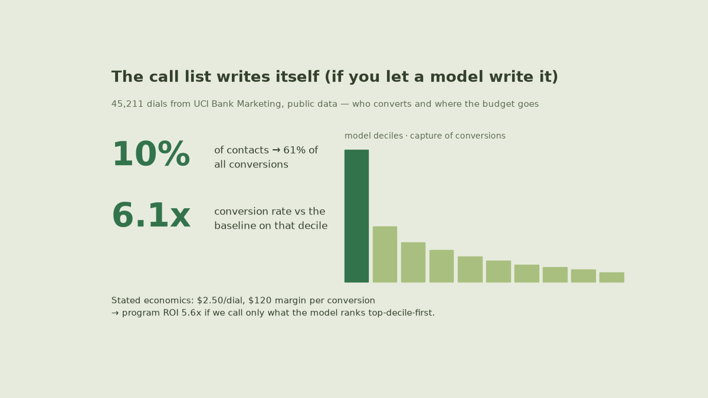

# Outbound campaigns: who converts, why, and what the next dollar buys



## Findings I'd defend in a meeting

1. **The model is the cheapest analyst you can hire.** Top decile = **10% of dials,
   61% of conversions**, at **6.1×** the baseline rate per call. GBDT with a
   logistic side-check, stratified split, AUC recorded in `outputs/model.json`.
2. **May dials a lot and converts badly.** Volume peaks in May at the *bottom*-tier
   conversion rate; autumn shoulder months convert at multiples of May with a
   fraction of the dials. Rebalancing the calendar costs nothing.
3. **"Yes last time" is near-destiny.** Prior-success contacts convert at
   **64.7%** vs the 9.2% general run — keep a re-listed group instead of cold
   treatment.
4. **Fewer calls ≠ less revenue.** ~2.76 avg calls per contact is the current spend
   pattern; the decile-ranked list beats it on both cost and yield.


## Model card

| | |
|---|---|
| data | UCI Bank Marketing, 45,211 dials, 11.7% baseline conversion, no PII |
| model | GBDT + logistic baseline, stratified split; AUC + decile lift in `model.json` |
| scoring file | `outputs/target_scores.csv` — ranked, ready to paste into a dialer |
| economics | stated $2.50/dial, $120 margin/conversion → 5.6× program ROI |

## Where the money currently goes (assumptions on the table)

Total dial cost **$113,028** against **$634,680** conversion margin at the stated
economics — **ROI 5.62×** for the modeled targeting vs the historical spray. The
cost figures are written down in `kpis.json`, and the script recomputes on edit.

## Use it

```bash
python3 -m venv .venv && .venv/bin/pip install -r requirements.txt
.venv/bin/python src/00_download_data.py      # data also ships in data/raw
.venv/bin/python src/01_analysis.py           # segments + monthly reads
.venv/bin/python src/02_targeting_model.py    # scored file + lift table
.venv/bin/python src/04_dashboard.py          # dashboard/index.html
.venv/bin/python src/05_banner.py             # banner above

.venv/bin/python src/06_chat.py "deciles"     # top 10% → 61% of conversions
.venv/bin/python src/06_chat.py "roi"         # 13,028 dial cost vs 34,680 margin
```

The chat recomputes every answer from local files at request time — deciles,
conversion by previous outcome, best/worst months, channel, top jobs, the ROI
math. Give `GROQ_API_KEY` to scripts 03/06 for LLM-in-the-loop narration of those
same numbers; without it the offline engine returns identical figures.


## Limits I won't paper over

No incremental/uplift ground truth in this dataset — before reallocating real
budget, run the randomized next-wave A/B. Economics are stated, not measured.
